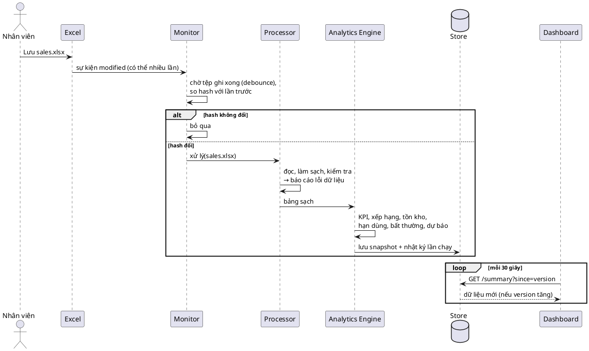
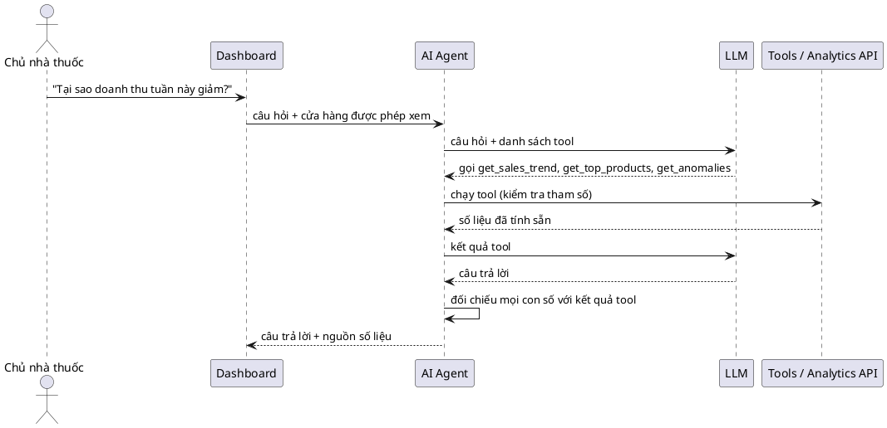

# Pharmacy Intelligent Analytics: kiến trúc

Hệ thống Agent thông minh giám sát, phân tích và trực quan hóa dữ liệu kinh doanh nhà thuốc.

## Nguyên tắc cốt lõi

```
DATA → MONITORING → PROCESSING → ANALYTICS → STORAGE → DASHBOARD → AI AGENT
```

- Monitoring, Processing, Analytics **không gọi LLM**. Tệp đổi 100 lần thì xử lý 100 lần, 0 lượt gọi API.
- AI Agent chỉ là lớp phía trên: chỉ gọi khi người dùng hỏi, chỉ đọc số liệu qua các tool định nghĩa sẵn, không chạy SQL tùy ý, không tự tính số.
- Analytics Engine trả lời "điều gì đang xảy ra"; AI Agent trả lời "vì sao" và "nên làm gì".

## Quyết định kiến trúc

| # | Quyết định | Lý do |
|---|---|---|
| D1 | Giữ **Node.js + PostgreSQL + React** của phần mềm quản lý (đóng vai trò "Laravel + MySQL" trong đề bài); thêm **`analytics-service/` bằng Python** | Hệ thống lõi đã đủ nghiệp vụ và có 745 test; viết lại bằng Laravel tốn nhiều tháng mà không thêm giá trị cho phần AI/BI. Python là lựa chọn chuẩn cho pandas, dự báo, ML |
| D2 | **Mỗi cửa hàng đúng một nguồn bán hàng**: hoặc CSDL phần mềm, hoặc tệp Excel/CSV | Tránh đếm doanh thu hai lần |
| D3 | Analytics Store dùng **SQLite** ở MVP | Một tệp, không cần cài; chuyển sang schema `analytics` của PostgreSQL khi cần nhiều máy đọc |
| D4 | AI Agent đặt trong `analytics-service/app/agent/` ở giai đoạn đầu | Tool gọi hàm Python trực tiếp, bớt một service; tách ra sau dễ |
| D5 | Dashboard gọi qua Node Gateway `/api/v1/bi/*` | Dùng lại đăng nhập và phân quyền theo cửa hàng; analytics-service không mở ra Internet |
| D6 | Đọc `.xlsx` bằng **calamine**, dự phòng openpyxl | Đo trên 32.000 dòng: calamine 0,6 giây, openpyxl 4 giây; kết quả giống hệt |

## Thành phần

```plantuml
@startuml component
skinparam componentStyle rectangle
package "Nguồn dữ liệu" {
  [Excel / CSV\n(data/inbox)] as XLS
  database "PostgreSQL\n(phần mềm quản lý)" as PG
}
package "analytics-service (Python)" {
  [Monitor\nwatchdog + polling] as MON
  [Processor\nloader, cleaner, validator] as PROC
  [Analytics Engine\nKPI, tồn kho, hạn dùng] as ENG
  [Anomaly + Forecast] as AF
  database "Analytics Store\nSQLite" as STORE
  [Analytics API\nFastAPI] as API
  [AI Agent\ntool calling] as AGENT
}
package "Hệ thống hiện có" {
  [Node.js Gateway\nauth, phân quyền] as GW
  [React Dashboard] as UI
}
cloud "LLM API" as LLM
XLS --> MON
PG --> MON : kiểm tra thay đổi
MON --> PROC --> ENG --> AF --> STORE
API --> STORE : chỉ đọc
AGENT --> API : chỉ qua tool
AGENT --> LLM : chỉ khi người dùng hỏi
UI --> GW --> API
GW --> AGENT
@enduml
```

## Luồng 1: tệp Excel thay đổi (không gọi LLM)



## Luồng 2: người dùng hỏi AI



## Pipeline và Analytics Store (bước 1.4)

Code: `analytics-service/app/pipeline.py`, `app/store/sqlite_store.py`. Lệnh: `python main.py run`, `python main.py status`.

| Tình huống | Đọc lại tệp | Tính lại KPI | Kết quả |
|---|---|---|---|
| Tệp đổi nội dung (khác SHA-256) | có | có | `processed`, snapshot mới |
| Tệp không đổi, snapshot dưới 5 phút | không | không | `unchanged`, không ghi gì |
| Tệp không đổi, snapshot cũ hơn 5 phút | không (dùng dữ liệu sạch trong bộ nhớ) | có | `refreshed`, snapshot mới |
| Tệp hỏng, thiếu cột, đang bị khóa | — | — | `failed`, ghi nhật ký, **giữ snapshot tốt gần nhất** |

- Phát hiện thay đổi hai lớp: so kích thước + thời điểm sửa (gần như miễn phí); chỉ khi khác mới tính
  SHA-256 của nội dung. Mở Excel rồi Lưu mà không sửa gì: hash y nguyên, bỏ qua.
- Tính lại theo thời gian vì "hôm nay", "tuần này" trôi theo đồng hồ: qua nửa đêm "hôm nay" phải về 0.
- Trạng thái nhớ qua SQLite: khởi động lại tiến trình, tệp không đổi vẫn được bỏ qua.
- Ghi run, snapshot, lỗi dữ liệu, kpi_daily trong **một transaction**: ghi đủ hoặc không ghi gì.

| Bảng | Nội dung | Giữ |
|---|---|---|
| `runs` | Mỗi lần chạy: thời gian, trạng thái, nguồn kích hoạt, tệp (size, mtime, sha256, số dòng), lỗi, ms | 200 lần |
| `snapshots` | Kết quả đã tính (JSON): KPI toàn chuỗi + từng cửa hàng, chuỗi 90 ngày, theo tháng, cơ cấu tháng, top 20 thuốc, chất lượng dữ liệu; `version` tăng dần | 30 bản |
| `data_issues` | Lỗi dữ liệu theo lần chạy có đọc tệp | 20 lần |
| `kpi_daily` | Doanh thu, giá vốn, lợi nhuận, số đơn, số lượng theo ngày × cửa hàng | Toàn bộ (thay mới mỗi lần đọc tệp) |

Dữ liệu mẫu (32.000 dòng): snapshot khoảng 60 KB, tệp SQLite khoảng 180 KB, một lần xử lý khoảng 1,9 giây.

## Lộ trình

| Phase | Nội dung | Trạng thái |
|---|---|---|
| 1.1 | Schema chuẩn, dữ liệu mẫu (3 cửa hàng, 60 mặt hàng, 90 ngày) | Xong |
| 1.2 | Processor: đọc, làm sạch, kiểm tra, báo cáo lỗi dữ liệu | Xong |
| 1.3 | KPI Engine: doanh thu, giá vốn, lợi nhuận, biên, số đơn, tăng trưởng ([kpi.md](kpi.md)) | Xong |
| 1.4 | Analytics Store (SQLite) + pipeline: phát hiện thay đổi bằng size/mtime rồi SHA-256, snapshot có version | Xong |
| 1.5 | Monitor: watchdog + debounce + hash, polling dự phòng | |
| 1.6 | FastAPI: `/summary`, `/revenue`, `/sales-trend`, `/health` | |
| 1.7 | Node Gateway + trang "Bảng điều hành" tự cập nhật | |
| 2 | Tồn kho, hạn dùng (5 mức), FEFO, top sản phẩm, cảnh báo | |
| 3 | Bất thường (luật → Z-score/IQR), dự báo (MA → Holt-Winters), backtest | |
| 4 | AI Agent: tool calling, đối chiếu số, nhật ký, bộ câu hỏi đánh giá | |
| 5 | Gợi ý đặt hàng, ABC, ML nâng cao, nguồn PostgreSQL | |

Schema dữ liệu và luật kiểm tra: [data-schema.md](data-schema.md). Công thức KPI: [kpi.md](kpi.md).
