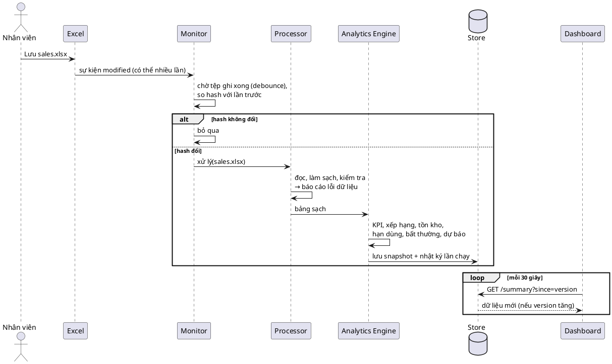
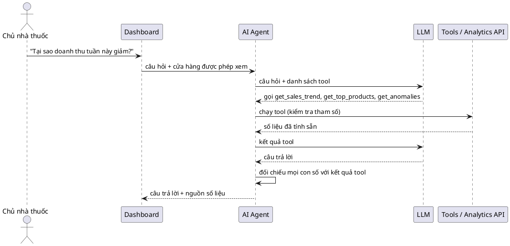

# Pharmacy Intelligent Analytics: kiến trúc

Hệ thống Agent thông minh giám sát, phân tích và trực quan hóa dữ liệu kinh doanh nhà thuốc.

## Nguyên tắc cốt lõi

```
DATA → MONITORING → PROCESSING → ANALYTICS → STORAGE → DASHBOARD → AI AGENT
```

- Monitoring, Processing, Analytics **không gọi LLM**. Tệp đổi 100 lần thì xử lý 100 lần, 0 lượt gọi API.
- AI Agent chỉ là lớp phía trên: chỉ gọi khi người dùng hỏi, chỉ đọc số liệu qua các tool định nghĩa sẵn, không chạy SQL tùy ý, không tự tính số.
- Analytics Engine trả lời "điều gì đang xảy ra"; AI Agent trả lời "vì sao" và "nên làm gì".

## Quyết định kiến trúc

| # | Quyết định | Lý do |
|---|---|---|
| D1 | Giữ **Node.js + PostgreSQL + React** của phần mềm quản lý (đóng vai trò "Laravel + MySQL" trong đề bài); thêm **`analytics-service/` bằng Python** | Hệ thống lõi đã đủ nghiệp vụ và có 745 test; viết lại bằng Laravel tốn nhiều tháng mà không thêm giá trị cho phần AI/BI. Python là lựa chọn chuẩn cho pandas, dự báo, ML |
| D2 | **Mỗi cửa hàng đúng một nguồn bán hàng**: hoặc CSDL phần mềm, hoặc tệp Excel/CSV | Tránh đếm doanh thu hai lần |
| D3 | Analytics Store dùng **SQLite** ở MVP | Một tệp, không cần cài; chuyển sang schema `analytics` của PostgreSQL khi cần nhiều máy đọc |
| D4 | AI Agent đặt trong `analytics-service/app/agent/` ở giai đoạn đầu | Tool gọi hàm Python trực tiếp, bớt một service; tách ra sau dễ |
| D5 | Dashboard gọi qua Node Gateway `/api/v1/bi/*` | Dùng lại đăng nhập và phân quyền theo cửa hàng; analytics-service không mở ra Internet |
| D6 | Đọc `.xlsx` bằng **calamine**, dự phòng openpyxl | Đo trên 32.000 dòng: calamine 0,6 giây, openpyxl 4 giây; kết quả giống hệt |
| D7 | Tồn kho lấy từ **tệp tồn hiện tại theo lô** (`inventory.xlsx`), không tự tính nhập − bán; "tồn tính đến" = giờ lưu tệp | Đơn giản, dễ kiểm; tự tính chỉ cần thiếu một chứng từ là sai dây chuyền. Phiếu nhập để Phase 5 |
| D8 | Tồn kho, hạn dùng (có giá nhập) cần quyền **`report.inventory`**; xếp hạng sản phẩm cần `report.sales` | Giá nhập và tồn là thông tin nhạy cảm với nhân viên bán hàng |
| D9 | Ngưỡng mặc định trong `config.py`: ADS tính trên 30 ngày; sắp hết khi số ngày tồn < 7 hoặc dưới `min_stock`; tồn cao khi > 90 ngày hoặc trên `max_stock`; tồn chết khi còn tồn mà 30 ngày không bán; hạn dùng 5 mức 0/7/30/90 ngày | Theo master prompt §13, §14; sửa một chỗ là đổi toàn hệ thống |

## Thành phần

```plantuml
@startuml component
skinparam componentStyle rectangle
package "Nguồn dữ liệu" {
  [Excel / CSV\n(data/inbox)] as XLS
  database "PostgreSQL\n(phần mềm quản lý)" as PG
}
package "analytics-service (Python)" {
  [Monitor\nwatchdog + polling] as MON
  [Processor\nloader, cleaner, validator] as PROC
  [Analytics Engine\nKPI, tồn kho, hạn dùng] as ENG
  [Anomaly + Forecast] as AF
  database "Analytics Store\nSQLite" as STORE
  [Analytics API\nFastAPI] as API
  [AI Agent\ntool calling] as AGENT
}
package "Hệ thống hiện có" {
  [Node.js Gateway\nauth, phân quyền] as GW
  [React Dashboard] as UI
}
cloud "LLM API" as LLM
XLS --> MON
PG --> MON : kiểm tra thay đổi
MON --> PROC --> ENG --> AF --> STORE
API --> STORE : chỉ đọc
AGENT --> API : chỉ qua tool
AGENT --> LLM : chỉ khi người dùng hỏi
UI --> GW --> API
GW --> AGENT
@enduml
```

## Luồng 1: tệp Excel thay đổi (không gọi LLM)



## Luồng 2: người dùng hỏi AI



## Pipeline và Analytics Store (bước 1.4)

Code: `analytics-service/app/pipeline.py`, `app/store/sqlite_store.py`. Lệnh: `python main.py run`, `python main.py status`.

| Tình huống | Đọc lại tệp | Tính lại KPI | Kết quả |
|---|---|---|---|
| Tệp đổi nội dung (khác SHA-256) | có | có | `processed`, snapshot mới |
| Tệp không đổi, snapshot dưới 5 phút | không | không | `unchanged`, không ghi gì |
| Tệp không đổi, snapshot cũ hơn 5 phút | không (dùng dữ liệu sạch trong bộ nhớ) | có | `refreshed`, snapshot mới |
| Tệp hỏng, thiếu cột, đang bị khóa | — | — | `failed`, ghi nhật ký, **giữ snapshot tốt gần nhất** |

- Phát hiện thay đổi hai lớp: so kích thước + thời điểm sửa (gần như miễn phí); chỉ khi khác mới tính
  SHA-256 của nội dung. Mở Excel rồi Lưu mà không sửa gì: hash y nguyên, bỏ qua.
- Tính lại theo thời gian vì "hôm nay", "tuần này" trôi theo đồng hồ: qua nửa đêm "hôm nay" phải về 0.
- Trạng thái nhớ qua SQLite: khởi động lại tiến trình, tệp không đổi vẫn được bỏ qua.
- Ghi run, snapshot, lỗi dữ liệu, kpi_daily trong **một transaction**: ghi đủ hoặc không ghi gì.

| Bảng | Nội dung | Giữ |
|---|---|---|
| `runs` | Mỗi lần chạy: thời gian, trạng thái, nguồn kích hoạt, tệp (size, mtime, sha256, số dòng), lỗi, ms | 200 lần |
| `snapshots` | Kết quả đã tính (JSON): KPI toàn chuỗi + từng cửa hàng, chuỗi 90 ngày, theo tháng, cơ cấu tháng, top 20 thuốc, chất lượng dữ liệu; `version` tăng dần | 30 bản |
| `data_issues` | Lỗi dữ liệu theo lần chạy có đọc tệp | 20 lần |
| `kpi_daily` | Doanh thu, giá vốn, lợi nhuận, số đơn, số lượng theo ngày × cửa hàng | Toàn bộ (thay mới mỗi lần đọc tệp) |

Dữ liệu mẫu (32.000 dòng): snapshot khoảng 60 KB, tệp SQLite khoảng 180 KB, một lần xử lý khoảng 1,9 giây.

## File Monitor (bước 1.5)

Code: `analytics-service/app/monitor/watcher.py`. Lệnh: `python main.py watch` (theo dõi `data/inbox`).

Excel lưu tệp bằng cách ghi tệp tạm rồi đổi tên, nên một lần bấm Lưu sinh 3–6 sự kiện. Monitor:

| Cơ chế | Chi tiết |
|---|---|
| Sự kiện (watchdog) | Chỉ nhận `created`, `modified`, `moved`, `deleted`, `closed`. Bỏ `opened`/`closed_no_write`: chính pipeline mở tệp để đọc cũng sinh các sự kiện này |
| Lọc tệp | Chỉ `sales`, `medicines` (`.xlsx`, `.csv`); bỏ `~$…`, tệp bắt đầu bằng dấu chấm, tệp tạm không đuôi. Sự kiện `moved` xét cả tên đích |
| Debounce | Yên lặng 2 giây mới xử lý: một đợt sự kiện thành một lần chạy |
| Kiểm tra ổn định | Kích thước tệp đứng yên qua hai lần đo cách 0,5 giây |
| Polling dự phòng | Mỗi 30 giây gọi pipeline: bắt sự kiện bị lỡ (OneDrive, ổ mạng), làm mới KPI theo giờ. Tệp lỗi y nguyên thì polling bỏ qua, không ghi "failed" lặp lại |
| Thử lại | Lần chạy do sự kiện thất bại (tệp đang bị khóa): thử lại sau 5 giây, tối đa 3 lần |
| Một luồng ghi | Luồng watchdog chỉ ghi mốc thời gian; pipeline luôn chạy ở vòng lặp chính, không bao giờ hai lần ghi SQLite cùng lúc |
| Log | Màn hình + `data/logs/monitor.log` (xoay vòng 5 × 1 MB), giờ Việt Nam, có độ trễ "lưu tệp → snapshot" |

Đo trên dữ liệu mẫu 32.000 dòng (CSV, `scripts/simulate_sales.py` thêm 20 hóa đơn mỗi 6 giây):
3/3 lần lưu được xử lý đúng một lần mỗi lần, độ trễ 4,3–4,7 giây
(2 giây debounce + 0,5 giây kiểm tra ổn định + khoảng 1,9 giây xử lý).

## Analytics API (bước 1.6)

Code: `analytics-service/app/api/routes.py`. Lệnh: `python main.py serve` (API + Monitor trong một tiến trình;
Monitor ở luồng nền là nơi duy nhất ghi SQLite). Tài liệu tự sinh: `http://127.0.0.1:8000/docs`.

- **Chỉ đọc**: chỉ có GET (có test kiểm tra). Không gọi LLM. Mỗi endpoint về sau là một tool của AI Agent.
- Chỉ nghe ở `127.0.0.1`; Node Gateway (bước 1.7) đứng trước để kiểm tra đăng nhập, phân quyền.
- Mọi phản hồi có `version` và `as_of`. Snapshot đã giải mã được giữ trong bộ nhớ, chỉ đọc lại khi version tăng.
- Lỗi: chưa có snapshot 503; mã cửa hàng không có 404; tham số sai 422.

| Endpoint (GET, tiền tố `/api/analytics`) | Tham số | Trả về | Tool Agent |
|---|---|---|---|
| `/version` | | version, as_of (để polling) | |
| `/health` | | trạng thái, snapshot (tuổi), lần chạy cuối, thống kê Monitor | |
| `/summary` | `store` (ALL, CH01…) | KPI hôm nay/tuần/tháng, kỳ so sánh, tăng trưởng, chất lượng dữ liệu | get_business_summary |
| `/revenue` | `period` (day/week/month), `store` | doanh thu, số đơn, số lượng, giá trị đơn | get_revenue |
| `/profit` | `period`, `store` | giá vốn, lợi nhuận, biên, độ phủ giá vốn | get_profit |
| `/sales-trend` | `grain` (day/week/month), `store`, `start`, `end` | chuỗi từ `kpi_daily`; kỳ đầu lùi về đầu tuần/tháng; kỳ đang dở có `partial: true` | get_sales_trend |
| `/breakdown` | `by` (category, sale_type, store, payment_method, top_medicines) | cơ cấu tháng này | get_top_products |
| `/data-quality` | `limit` | lỗi dữ liệu lần đọc tệp gần nhất | |
| `/runs` | `limit` | nhật ký pipeline | |

Đo trên máy chủ thật, 50 lần mỗi endpoint, dữ liệu 32.000 dòng: trung vị 2–3 ms (snapshot), 10–11 ms
(`sales-trend`); p95 dưới 13 ms.

## Node Gateway và Bảng điều hành (bước 1.7)

Code: `server/src/modules/bi/` (cổng), `client/src/features/bi/` (trang `/bang-dieu-hanh`, nhóm Báo cáo).

```
Trình duyệt ──JWT──▶ Node /api/v1/bi/* ──(đã kiểm quyền)──▶ analytics-service 127.0.0.1:8000
```

- Cần quyền `report.sales` hoặc `report.chain`. **Quy ước:** `store_code` trong tệp trùng mã cửa hàng của phần mềm.
- Có quyền báo cáo ở **mọi** cửa hàng: xem toàn chuỗi (`ALL`), cơ cấu, lỗi dữ liệu.
  Chỉ ở một số cửa hàng: mặc định cửa hàng đầu tiên; hỏi `ALL` hoặc cửa hàng khác bị 403;
  `/summary` bị lọc danh sách cửa hàng và bỏ `data_quality` (thống kê đó tính trên cả tệp);
  `/breakdown`, `/data-quality` bị 403.
- Chỉ chuyển tiếp endpoint và tham số trong danh sách cho phép (zod). Thông báo 404 gốc liệt kê mọi
  cửa hàng nên được thay bằng câu chung. `/health` bỏ đường dẫn thư mục trên máy chủ.
- Dịch vụ chưa chạy: 502 `ANALYTICS_UNAVAILABLE` kèm cách bật; chưa có số liệu: 503 `ANALYTICS_NO_DATA`.
- Địa chỉ dịch vụ: biến `ANALYTICS_SERVICE_URL` (mặc định `http://127.0.0.1:8000`), timeout 5 giây.

Tự cập nhật: trang hỏi `/bi/version` mỗi 30 giây. Version nằm trong khóa truy vấn của mọi khối số liệu
nên version tăng thì các khối tự tải lại, không tải lại trang. Độ trễ tối đa ≈ 30 giây (polling)
+ 2 giây (debounce) + ~2 giây (xử lý) < 60 giây.

Đo thật (Playwright, 32.000 dòng): thêm 5 hóa đơn vào `sales.csv` → thẻ doanh thu tự đổi sau 26,5 giây,
tăng đúng bằng tổng 5 hóa đơn. **Đạt tiêu chí MVP.**

## Phase 2: thiết kế đã chốt

**Tồn kho** (mỗi thuốc, mỗi cửa hàng; lô đã hết hạn không tính là tồn bán được):

```
Tồn hiện tại      = Σ quantity các lô chưa hết hạn
ADS               = số lượng bán 30 ngày gần nhất / 30
Số ngày tồn       = Tồn hiện tại / ADS        (ADS = 0: "không bán được")
Giá trị tồn       = Σ quantity × purchase_price
```

| Trạng thái | Điều kiện |
|---|---|
| Hết hàng | tồn = 0 nhưng 30 ngày qua có bán |
| Sắp hết | tồn < min_stock hoặc số ngày tồn < 7 |
| Tồn cao | tồn > max_stock hoặc số ngày tồn > 90 |
| Tồn chết | còn tồn, 30 ngày không bán |
| Bình thường | còn lại |

**Hạn dùng 5 mức** (ngày còn lại = hạn − hôm nay): đã hết hạn < 0; nguy cấp 0–7; cảnh báo 8–30;
theo dõi 31–90; bình thường > 90.

**FEFO, số lượng có nguy cơ không kịp bán:** xếp lô theo hạn gần trước, giả định bán đúng thứ tự với tốc độ ADS.

```
đã_dùng = 0
mỗi lô theo hạn tăng dần:
    bán_được    = min(quantity, max(0, ngày_còn_lại − đã_dùng) × ADS)
    có_nguy_cơ  = quantity − bán_được      (× giá nhập = tiền có thể mất)
    đã_dùng    += quantity / ADS
```

Ví dụ: ADS 10 hộp/ngày; lô A 50 hộp còn 7 ngày → bán hết sau 5 ngày, an toàn; lô B 200 hộp còn 12 ngày → chỉ còn
7 ngày để bán, được 70 hộp, **130 hộp có nguy cơ**.

**Cảnh báo theo luật:** lô hết hạn còn trong kho (nguy cấp); lô nguy cấp/cảnh báo; hàng có nguy cơ không kịp bán;
hết hàng/sắp hết; doanh thu hôm nay giảm ≥ 20% so với hôm qua cùng giờ; tệp có dòng lỗi.

Thiếu `inventory.xlsx` thì phần bán hàng vẫn chạy; các khối tồn kho báo "Chưa có tệp tồn kho".

## Lộ trình

| Phase | Nội dung | Trạng thái |
|---|---|---|
| 1.1 | Schema chuẩn, dữ liệu mẫu (3 cửa hàng, 60 mặt hàng, 90 ngày) | Xong |
| 1.2 | Processor: đọc, làm sạch, kiểm tra, báo cáo lỗi dữ liệu | Xong |
| 1.3 | KPI Engine: doanh thu, giá vốn, lợi nhuận, biên, số đơn, tăng trưởng ([kpi.md](kpi.md)) | Xong |
| 1.4 | Analytics Store (SQLite) + pipeline: phát hiện thay đổi bằng size/mtime rồi SHA-256, snapshot có version | Xong |
| 1.5 | Monitor: watchdog + debounce + kiểm tra ổn định, polling dự phòng, thử lại | Xong |
| 1.6 | Analytics API (FastAPI) chỉ đọc, chạy chung tiến trình với Monitor: `python main.py serve` | Xong |
| 1.7 | Node Gateway `/api/v1/bi` (đăng nhập, quyền theo cửa hàng) + trang "Bảng điều hành" tự cập nhật | Xong |
| 2.1 | Schema `inventory.xlsx`, luật kiểm tra, dữ liệu mẫu khớp sales | Xong |
| 2.2 | Phân tích sản phẩm: top doanh thu/lợi nhuận, lợi nhuận thấp, giảm mạnh, bán chậm, lâu không bán ([kpi.md](kpi.md#phân-tích-sản-phẩm-phase-2-bước-22)) | Xong |
| 2.3 | Phân tích tồn kho: ADS, số ngày tồn, giá trị tồn, 5 trạng thái | |
| 2.4 | Hạn dùng 5 mức + FEFO: số lượng và tiền có nguy cơ không kịp bán | |
| 2.5 | Cảnh báo theo luật; snapshot; Analytics API `/products`, `/inventory`, `/expiry`, `/alerts` | |
| 2.6 | Gateway (quyền D8) + Bảng điều hành: thẻ KPI tồn kho, khối Cảnh báo, tab Tồn kho / Hạn dùng / Sản phẩm | |
| 3 | Bất thường (luật → Z-score/IQR), dự báo (MA → Holt-Winters), backtest | |
| 4 | AI Agent: tool calling, đối chiếu số, nhật ký, bộ câu hỏi đánh giá | |
| 5 | Gợi ý đặt hàng, ABC, ML nâng cao, nguồn PostgreSQL | |

Schema dữ liệu và luật kiểm tra: [data-schema.md](data-schema.md). Công thức KPI: [kpi.md](kpi.md).
